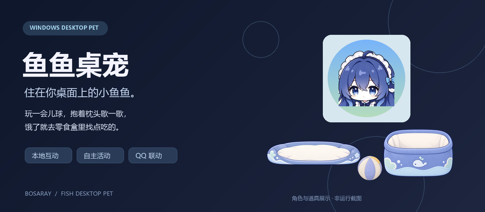
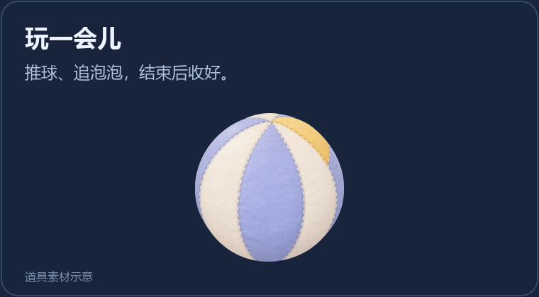
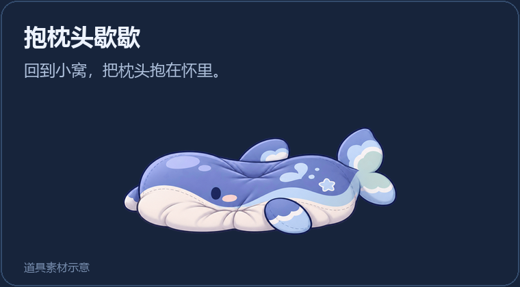
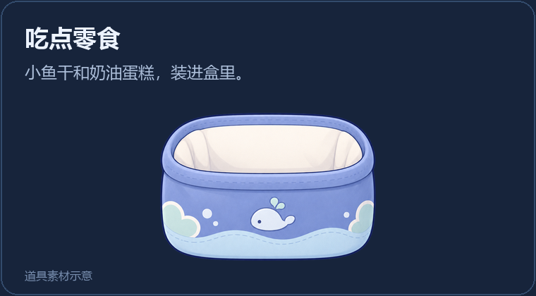
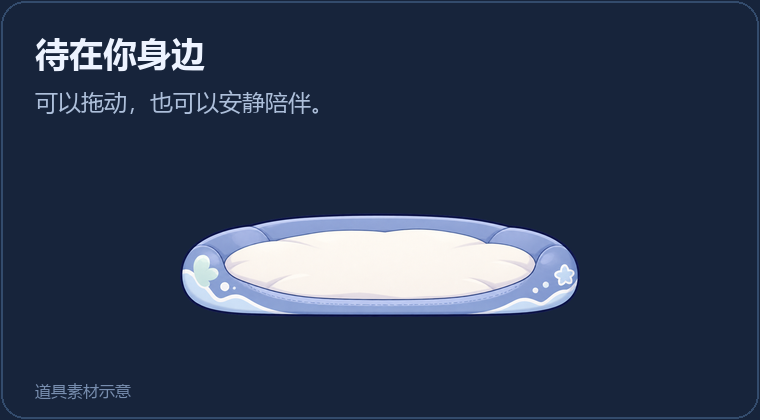

<p align="center">
  
</p>

<p align="center">
  <strong>会玩耍、会休息，也会自己找点零食吃的桌面小伙伴。</strong>
</p>

<p align="center">
  <a href="docs/build.md"></a>
  <a href="app/package.json"></a>
  <a href="LICENSE.txt"></a>
</p>

<p align="center">
  <a href="#认识鱼鱼">认识鱼鱼</a> ·
  <a href="#开始使用">开始使用</a> ·
  <a href="docs/build.md">从源码构建</a> ·
  <a href="docs/connection.md">QQ 联动</a> ·
  <a href="https://github.com/Bosaray/fish-desktop-pet/issues">反馈问题</a>
</p>

## 认识鱼鱼

把她拖到喜欢的位置，留一点地方给小窝和零食盒。空闲时，她可以追泡泡、推球，玩完收好；想休息了，就回小窝抱着枕头坐一会儿。

<table>
<tr>
<td width="50%"><br><strong>一起玩</strong><br>推球、追着泡泡跳，玩完把玩具收好。</td>
<td width="50%"><br><strong>歇一会儿</strong><br>回小窝抱枕头，抱紧时枕头也会变扁。</td>
</tr>
<tr>
<td><br><strong>吃点东西</strong><br>盒子装得下 8 份零食，打开后选小鱼干或奶油蛋糕。</td>
<td><br><strong>安静陪伴</strong><br>可以调整大小和置顶；普通自主动作失败不必逐项汇报。</td>
</tr>
</table>

<sub>以上为项目现有角色与道具的排版展示，不是桌面运行截图。真实动作录屏待补充。</sub>

还有这些互动：在权限允许时移动桌面图标、推动普通窗口、寻找窗沿休息。自主行为按概率和冷却选择，主人拖动或下达任务时可以打断。[查看当前自主行为设置](docs/autonomy-props.md)。

## 开始使用

**当前是持续开发中的测试版，面向 Windows 10 / 11 x64。仓库暂未发布可下载的安装包。**

| 你想做什么 | 从这里开始 |
|---|---|
| 从源码运行或打包 | [构建指南](docs/build.md) |
| 了解桌面操作 | [使用说明](docs/usage.md) |
| 接通 QQ 对话与动作 | [连接说明与当前限制](docs/connection.md) |
| 反馈问题或建议 | [GitHub Issues](https://github.com/Bosaray/fish-desktop-pet/issues) |

本地角色动画、桌面辅助程序和 QQ 联动是不同部分。完整 QQ 对话、模型回复、长期记忆及收藏展示需要兼容的配套服务端；本仓库提供桌宠客户端，不包含已配置好的 QQ 机器人或服务端账号。

## 平时怎么用

- **移动角色和道具：** 拖动鱼鱼、小窝或零食盒来摆放。
- **补充零食：** 点击零食盒，选择食物；装满 8 份后面板自动收起，再点可以打开。
- **选一个玩法：** 右键 →「和鱼鱼玩」。
- **找回道具：** 右键 →「摆放道具」。
- **调整大小、置顶或权限：** 右键 →「桌宠设置」。
- **暂时停下来：** 右键暂停自主活动，或选择停止当前动作。

## 连接与隐私

桌面图标、窗口、鼠标和屏幕观察分别由设置控制。QQ 联动需要单独配对；启用相关观察能力时，应了解配套服务端如何接收和处理屏幕资料。

仓库不附带个人聊天、记忆数据库、QQ 收藏、模型密钥或设备配对凭据。反馈问题时请遮挡私人内容，不要上传配对文件或密钥。[连接说明](docs/connection.md)

## 当前进度

| 状态 | 内容 |
|---|---|
| 已接入 | 泡泡、玩球收纳、小窝抱枕、零食盒、新道具素材、精简右键菜单 |
| 最近修复 | 自主失败消息静默、旧投喂按钮说明、鼠标穿透重复设置 |
| 待继续验证 | 部分机器上的拖动问题、多屏及复杂遮挡、全屏游戏覆盖 |
| 尚未提供 | 正式安装包、完整首次配对教程、其他系统支持 |

当前版本 **1.9.0-beta.13**。自动检查通过不代表所有桌面交互都已在不同设备验证；独占全屏游戏、桌面自动排列、窗口遮挡等条件也可能限制显示或动作。

## 开发与文档

客户端使用 Electron、JavaScript 和 Windows 原生辅助程序。

```text
app/       客户端、设置、骨骼渲染与互动
native/    Windows 桌面辅助程序源码
tests/     行为与状态回归检查
docs/      构建、连接和使用说明
art/       道具候选及处理记录
```

[构建指南](docs/build.md) · [自主行为配置](docs/autonomy-props.md) · [近期修复说明](docs/quiet-autonomy-fix.md) · [素材说明](docs/assets.md)

## 许可与致谢

代码许可见 [AGPL-3.0-or-later](LICENSE.txt)，上游项目和第三方组件声明见 [THIRD_PARTY_NOTICES.md](THIRD_PARTY_NOTICES.md)。

角色原设、贴图、声音、商标与其他第三方素材按各自声明处理，**不因代码许可自动获得相同授权**。头像和道具展示沿用项目已有素材；使用或分发前请查看[素材说明](docs/assets.md)。
